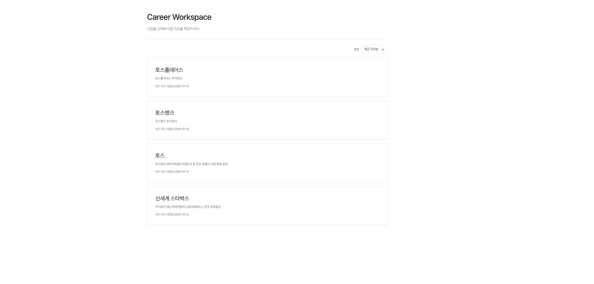

# Job Application Strategist

**Career Workspace** for organizing company research and job application materials.

**[Open the site →](https://nana-park.github.io/job-application-strategist/)**

## What it does

- Company Research
- JD Analysis
- Essay Question
- Application Strategy (지원전략)
- Employee Interviews (현직자 인터뷰)

## Structure and setup

Static HTML, CSS, and JavaScript, served on GitHub Pages without a build step.

- `index.html`: company list
- `company-*/`: company and job application materials
- `assets/fonts/`: bundled fonts
- `tools/`: document protection utilities and synthetic test pages

Serve the repository root with a static HTTP server for local use. GitHub Pages publishes the root (`/`) of `main` with `.nojekyll`; internal links and image paths are relative.

The screenshot shows the public home page without unlocked personal materials; `synthetic` and `demo` pages under `tools/` use synthetic data and public test keys.
