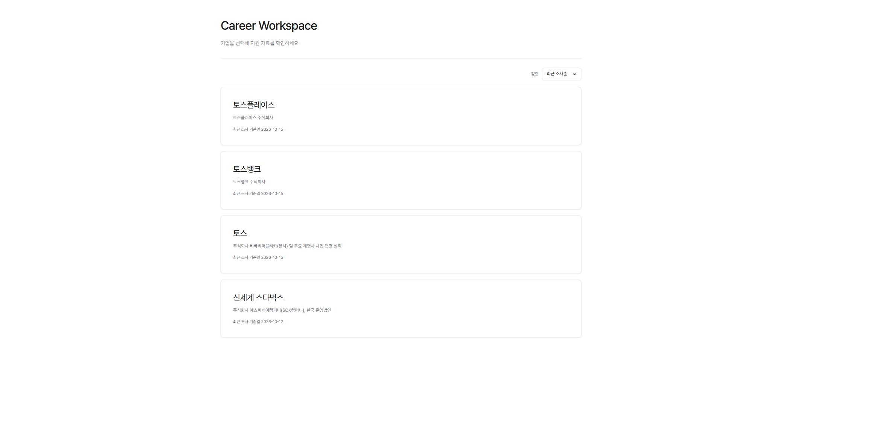

# Job Application Strategist

**Career Workspace** for organizing company research and job application materials.

## Content source and publishing

This repository is the presentation and publication site. The private **Application Writer Multi-Agent** workflow is the source of truth for the analysis instructions, JSON schemas, HTML renderers, and templates. This site is not a separate research workflow. The public `application-writing-agents` repository is not the source renderer for this site.

Authorized maintainers generate and validate reports in the private writer workspace, review the public content, then copy only approved HTML and required assets into this repository. Company reports are published under `company-*/<date>/report-*/`; job pages and related analyses are under `company-*/jobs/`. Private JSON, source notes, execution records, archives, and unprotected applicant information must stay out of the public export.

There is no background pull or sync from the private source. Authorized maintainers can explicitly run the writer's `scripts/writer_pipeline.py prepare` command to validate and stage allowed HTML/assets against a read-only copy of this site. Its `verify-prepare` and `publish-plan` commands check and describe the proposed export; they do not push. Content review, approval, promotion and publication remain separate steps. GitHub Pages serves committed files and currently does not enforce that private local gate. See the private writer README and `docs/writer-pipeline.md` for maintainer instructions; private access is not needed to read this site.

**[Open the site →](https://nana-park.github.io/job-application-strategist/)**

## What it does

- Company Research
- JD Analysis
- Essay Question
- Application Strategy (지원전략)
- Employee Interviews (현직자 인터뷰)

## Public landing page rules

- The outermost landing page is English: company display names, research dates and card actions. Keep Korean names in `data-company-name` and English names in `data-company-name-en` so both remain searchable. Research report bodies keep their original language.
- Before publishing a new company, replace the generic `Career notes` visual with its official logo under `assets/landing/`. Record its official source here. Match existing card sizing; do not redraw or distort the logo.
- Writer-generated new cards are provisional presentation. Review their logo and English copy before promotion; updates must preserve approved visuals and wording while refreshing the date.
- Verify the live landing page, both language searches, logo loading and the company/report link after deployment. A successful push alone is not completion.

Olive Young logo: https://corp.oliveyoung.com/img/common/logo/logo-493996034cacc186f5e6965f8d5b876f.svg (official corporate site, checked 2026-11-06).

## Structure and setup

Static HTML, CSS, and JavaScript, served on GitHub Pages without a build step.

- `index.html`: company list
- `company-*/`: company and job application materials
- `assets/fonts/`: bundled fonts
- `tools/`: document protection utilities and synthetic test pages

Serve the repository root with a static HTTP server for local use. GitHub Pages publishes the root (`/`) of `main` with `.nojekyll`; internal links and image paths are relative.

The screenshot shows the public home page without unlocked personal materials; `synthetic` and `demo` pages under `tools/` use synthetic data and public test keys.
